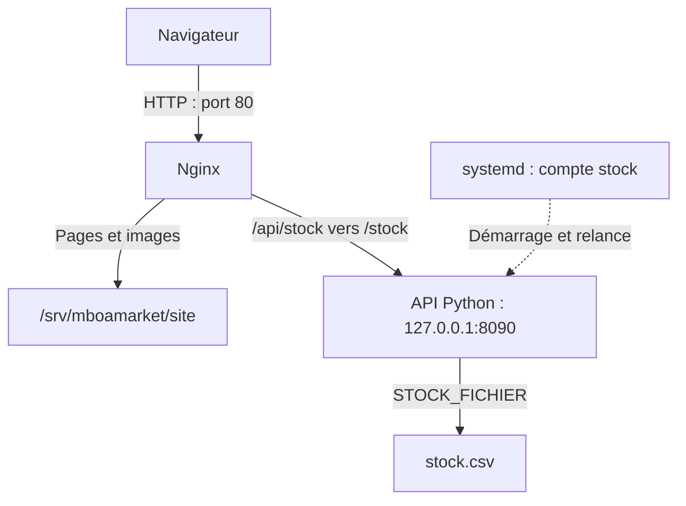

# Mboa Market — Déploiement d’une boutique sur Ubuntu

> Déploiement en pré-production d’une boutique et de son API de stock : Nginx, reverse proxy, service systemd, permissions Linux et résolution d’incidents.

## Le contexte

Mboa Market est une entreprise fictive située à Douala et à Montréal, utilisée dans un atelier de formation DevOps.

L’équipe fournit un site web et une API Python qui expose le stock des produits. Mon travail consiste à déployer ces composants sur Ubuntu, limiter leurs permissions et diagnostiquer les incidents de publication.

Ce dépôt contient les configurations Nginx et systemd du serveur, ainsi que le post-mortem d’un incident simulé. Le code applicatif et les données sont fournis séparément par le laboratoire.

## Ce que j’ai mis en place

| Besoin | Solution | Configuration |
|---|---|---|
| Permettre à Nadia de gérer le site sans être administratrice | Compte personnel, groupe `web`, dossier du site en `2775` | Configuration des comptes sur le serveur |
| Servir les pages de la boutique | Nginx avec un site dédié | [nginx/mboamarket](nginx/mboamarket) |
| Séparer les visites et les erreurs de la boutique | Journaux d’accès et d’erreurs dédiés | [nginx/mboamarket](nginx/mboamarket) |
| Démarrer et surveiller l’API | Service systemd avec `Restart=on-failure` | [systemd/mboa-stock.service](systemd/mboa-stock.service) |
| Exécuter l’API avec des droits limités | Compte système `stock`, sans connexion interactive | [systemd/mboa-stock.service](systemd/mboa-stock.service) |
| Exposer le site et l’API par Nginx | Reverse proxy de `/api/` vers le port local 8090 | [nginx/mboamarket](nginx/mboamarket) |
| Documenter les incidents 403 et 502 | Diagnostic, corrections et prévention | [Post-mortem](docs/post-mortem-2026-11-08.md) |

## Architecture



- Nginx expose la boutique sur le port 80.
- L’API écoute uniquement sur `127.0.0.1:8090` : les visiteurs y accèdent à travers Nginx.
- Le `/` final de `proxy_pass http://127.0.0.1:8090/;` permet de transmettre `/api/stock` à l’API sous le chemin `/stock`.
- systemd démarre l’API avec la machine et la relance en cas d’échec.
- La variable `STOCK_FICHIER` indique à l’API le chemin du fichier de données.

Le compte dédié `stock` limite les permissions du processus applicatif. Cette séparation évite d’exécuter l’API avec les privilèges de root.

## Sécurité et permissions

### Équipe web

Le dossier `/srv/mboamarket/site` appartient à `root:web`, avec les permissions `2775`.

- Le groupe `web` peut y créer et gérer les fichiers.
- Le setgid transmet le groupe `web` aux nouveaux fichiers et sous-dossiers.
- Les autres comptes peuvent lire et traverser le dossier, sans y créer de fichiers.
- L’écriture dans un fichier existant dépend aussi des permissions de ce fichier.

Les fichiers de promotions corrigés sont en `664` : le propriétaire et le groupe peuvent les modifier, les autres peuvent seulement les lire.

### Nginx et API

- Le processus maître Nginx tourne sous `root`.
- Les workers tournent sous `www-data` et lisent les fichiers du site sans pouvoir les modifier.
- L’API tourne sous le compte système `stock`, avec le shell `/usr/sbin/nologin`.
- L’API n’écoute pas directement sur une interface réseau externe.

Le dépôt ne contient ni mot de passe, ni clé privée, ni adresse IP publique du serveur.

## Structure du dépôt

- `README.md` : présentation, installation et vérifications.
- `nginx/mboamarket` : configuration du site Nginx.
- `systemd/mboa-stock.service` : unité systemd de l’API.
- `docs/post-mortem-2026-11-08.md` : analyse des incidents de publication.

## Installer les configurations sur un serveur

### Prérequis

- Ubuntu 24.04 et un compte disposant de sudo.
- Git et Python 3 installés.
- Une clé SSH reconnue par GitHub pour le clonage SSH.
- Le site déjà livré dans `/srv/mboamarket/site`.
- Le code et les données de l’API dans `/srv/mboamarket/stock`, notamment `stock.py` et `stock.csv`.

Les commandes suivantes concernent une première installation. Si un compte, un groupe ou un lien existe déjà, vérifier son état avant de répéter sa création.

### Récupérer le dépôt

```bash
git clone git@github.com:kamoustaph/mboa-market-serveur.git
cd mboa-market-serveur
```

### Configurer les comptes

```bash
sudo groupadd web
sudo useradd -m -s /bin/bash -G web nadia
sudo useradd --system --no-create-home --shell /usr/sbin/nologin stock
```

### Préparer les permissions du site

Pour les pages et les images statiques livrées dans cet atelier :

```bash
sudo chown root:web /srv/mboamarket/site
sudo chgrp -R web /srv/mboamarket/site
sudo find /srv/mboamarket/site -type d -exec chmod 2775 {} +
sudo find /srv/mboamarket/site -type f -exec chmod 664 {} +
```

Ces commandes donnent l’écriture à l’équipe web et la lecture à Nginx. Elles sont destinées au dossier du site statique de cet atelier.

### Installer et configurer Nginx

```bash
sudo apt update
sudo apt install -y nginx
sudo cp nginx/mboamarket /etc/nginx/sites-available/mboamarket
sudo ln -s /etc/nginx/sites-available/mboamarket /etc/nginx/sites-enabled/mboamarket
```

Désactiver le site par défaut si son lien est présent :

```bash
if [ -L /etc/nginx/sites-enabled/default ]; then
    sudo rm /etc/nginx/sites-enabled/default
fi
```

Tester avant de recharger :

```bash
sudo nginx -t && sudo systemctl reload nginx
sudo systemctl enable --now nginx
```

### Installer le service de l’API

```bash
sudo cp systemd/mboa-stock.service /etc/systemd/system/mboa-stock.service
sudo systemctl daemon-reload
sudo systemctl enable --now mboa-stock
```

L’unité contient notamment :

```ini
User=stock
Group=stock
Environment=STOCK_FICHIER=/srv/mboamarket/stock/stock.csv
ExecStart=/usr/bin/python3 /srv/mboamarket/stock/stock.py
Restart=on-failure
```

Le compte `stock` doit pouvoir traverser les dossiers et lire le code ainsi que le fichier de données.

## Vérifier que tout fonctionne

```bash
sudo nginx -t
systemctl is-active nginx
systemctl is-enabled nginx
systemctl is-active mboa-stock
systemctl is-enabled mboa-stock

curl -I http://localhost/
curl -I http://localhost/promo.html
curl -I http://localhost/images/novembre.svg
curl http://localhost/api/stock

sudo ss -tlnp | grep ':8090 '
ps -p "$(systemctl show mboa-stock -p MainPID --value)" -o user,pid,args
```

### Résultats observés

- La configuration Nginx passe le test de syntaxe.
- Nginx et l’API sont actifs et activés au démarrage.
- L’accueil, la page des promotions et son affiche répondent `200 OK`.
- L’API retourne le stock en JSON avec `"version": "novembre"`.
- L’API écoute sur `127.0.0.1:8090` et tourne sous `stock`.
- Le navigateur affiche les produits, les stocks et l’affiche des promotions.

## Journaux et diagnostic

```bash
sudo tail -n 10 /var/log/nginx/mboamarket.access.log
sudo tail -n 10 /var/log/nginx/mboamarket.error.log
sudo journalctl -u mboa-stock -n 30 --no-pager
```

Exemple réel d’une requête locale dans le journal d’accès :

```text
127.0.0.1 - - [09/Nov/2026:19:07:10 +0100] "GET / HTTP/1.1" 200 1848 "-" "curl/8.5.0"
```

Le journal d’accès permet de retrouver les requêtes et leurs codes HTTP. Le journal d’erreurs Nginx aide à diagnostiquer les problèmes de fichiers ou de connexion au backend. Le journal systemd contient les messages de démarrage et les erreurs Python.

## Test de relance automatique

Un arrêt forcé du processus de l’API a été réalisé dans le cadre de l’atelier pour simuler un plantage.

Le journal a montré :

```text
Main process exited, code=killed, status=9/KILL
Scheduled restart job, restart counter is at 1.
Started mboa-stock.service - API du stock de Mboa Market.
```

Le PID est passé de `15568` à `15873`, sans relance manuelle. L’API répondait de nouveau après cette relance.

## Incident de la version de novembre

L’incident a été reproduit le **9 novembre 2026**, pendant la réalisation de l’atelier du 8 novembre.

Après publication :

- L’accueil répondait toujours `200`.
- Les promotions répondaient `403 Forbidden`.
- Le stock répondait `502 Bad Gateway`.

### Promotions en 403

L’outil de publication imposait `umask 077`. Les nouveaux fichiers étaient créés en `600`, ce qui empêchait les workers Nginx de les lire.

La correction immédiate a consisté à passer les deux fichiers concernés en `664`. La correction de l’outil a consisté à remplacer `umask 077` par `umask 002`.

### Stock en 502

La nouvelle API exigeait la variable `STOCK_FICHIER`. Absente du service systemd, elle provoquait l’arrêt de Python avec :

```text
KeyError: 'STOCK_FICHIER'
```

L’ajout de la variable dans l’unité, suivi d’un rechargement systemd et d’une relance du service, a rétabli l’API sans modifier son code.

Le [post-mortem](docs/post-mortem-2026-11-08.md) détaille l’impact, la chronologie, les causes racines, les corrections et les actions préventives.

## Ce que j’ai appris

- Gérer des comptes humains et des comptes de service avec des permissions adaptées.
- Comprendre le rôle du setgid et de l’umask.
- Configurer Nginx pour servir un site et transmettre les appels à une API locale.
- Créer un service systemd et vérifier sa relance automatique.
- Diagnostiquer un 403 à partir des permissions et du journal Nginx.
- Diagnostiquer un 502 en remontant jusqu’aux erreurs du service backend.
- Tester une publication et documenter un incident avec des preuves.

## Limites du projet

Ce projet est un environnement pédagogique de pré-production. L’accès web utilise HTTP ; HTTPS n’a pas été configuré dans cet atelier.

Le dépôt versionne les configurations et la documentation. Le code applicatif, les données et l’outil de publication du laboratoire sont fournis séparément.

## Auteur

**Moustapha** — [Profil GitHub](https://github.com/kamoustaph)

Formation « Devenir Ingénieur DevOps » de Runbookly.
Atelier du 8 novembre 2026, réalisé le 9 novembre 2026.
